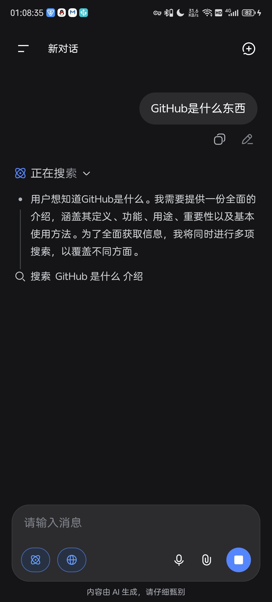
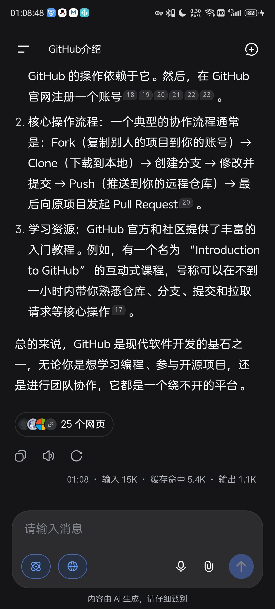
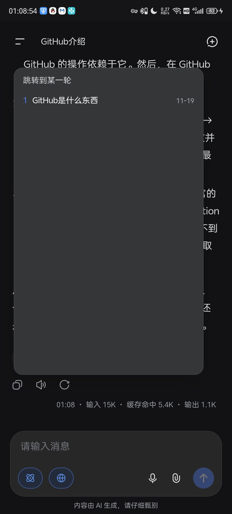
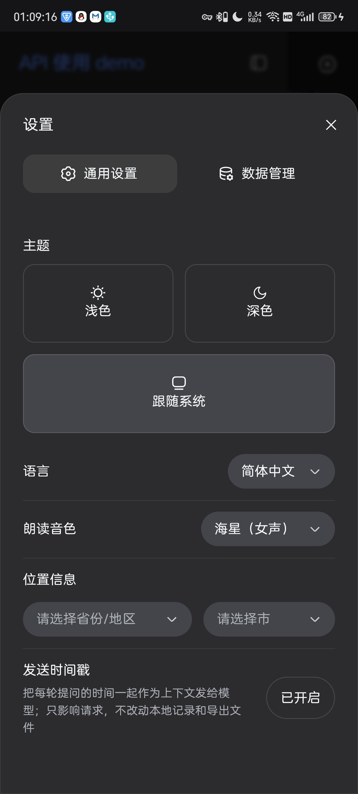
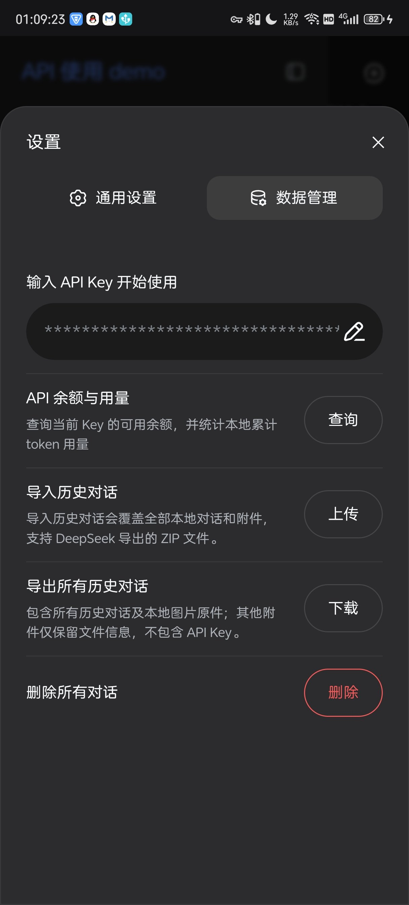

# DeepSeek 自建客户端（Android）

本项目**基于 DeepSeek 官方开源对话客户端 [deepseek-ai/chat-demo](https://github.com/deepseek-ai/chat-demo)（MIT）改造**：
把它的前端包进 Android WebView 外壳，并针对"自己长期使用"这个场景，补了一批交互、性能与数据安全方面的功能。

> **上游是什么**：`chat-demo` 是官方提供的**对话客户端演示项目**——纯前端静态页，直接调用 DeepSeek API，
> 不经过任何后端，能力与官网、官方 App 的对话功能一致（思考、联网搜索、阅读链接、文件、语音）。
> 它不是官方手机 App 的源码，本项目也不是从零编写，而是在它之上做封装与增强。
>
> **本项目是非官方项目**，与深度求索无隶属关系，仅适用于自用。请遵守
> [DeepSeek 开放平台服务协议](https://cdn.deepseek.com/policies/zh-CN/deepseek-open-platform-terms-of-service.html)。

## 为什么做这个

官方 App 的免费额度有限流。用 API 则是按 token 计费、没有每日条数上限，
重度个人使用每月几十块，还能自己决定界面。

## 截图

| 深度思考 + 搜索过程 | 回答、引用与 token 统计 | 轮次跳转 |
| --- | --- | --- |
|  |  |  |

| 通用设置 | 数据管理 |
| --- | --- |
|  |  |

## 使用说明

### 1. 首次打开

安装 APK 后打开，应用会直接弹出设置面板，把 DeepSeek 开放平台的 API Key
（`sk-` 开头）粘进去保存即可。Key 只存在手机本地，不会上传到任何地方。

### 2. 从官方客户端搬迁历史对话

官方手机 App 与网页版**共用同一账号、同一份对话记录**，导出入口在网页版：

1. 浏览器打开 <https://chat.deepseek.com> 并登录你的账号
2. 打开设置，找到「**导出数据 / 下载全部对话**」一类的入口，等待后台打包
3. 会得到一个 `deepseek_data-<日期>.zip`（有图片的账号可能上百 MB）
4. 把这个 zip 传到手机：微信「文件传输助手」、数据线、网盘都可以
5. 打开本应用 → **设置 → 数据管理 → 导入历史对话 → 上传** → 选中这个 zip
6. 弹出确认框后点 **确认导入**

导入完成后，侧边栏会出现全部旧对话，点开就能接着聊——上下文、图片、
思考记录都在。

> ⚠️ **导入是覆盖，不是合并**：本地原有的对话和附件会被清空替换。
> 所以第一次导入前，建议先在本应用里点一次「导出所有历史对话」留个底。
>
> ⏳ 会话多、附件多时导入需要**几分钟**（上千条对话 + 几百张图实测约 2~4 分钟），
> 期间会显示进度，请不要离开页面或锁屏。
>
> 💡 官方归档里每条消息都带完整时间戳，导入后会在每轮底部显示；
> 但官方的归档**不含** token 用量明细，所以旧对话的「缓存命中/输出 token」是空的，
> 只有本应用里新产生的回答才有。

### 3. 备份与换机

本应用没有云端同步，数据只在这台手机上。

- **备份**：设置 → 数据管理 → **下载**（导出全部对话为 zip）
- **换机 / 恢复**：新手机装好应用后，用上面的「导入历史对话」把 zip 导回去

导出的包与官方格式兼容，所以既可以导回本应用，也能作为通用备份长期保存。

### 4. 日常使用小技巧

- **长对话找位置**：按住屏幕**右边缘**呼出轮次列表，上下拖动快速定位，点某一轮直接跳过去
- **返回键**：任何时候按返回都是"退回上一层"（关面板 → 关抽屉 → 回主页 → 才退出）
- **侧边栏**：在页面上**任意位置右滑**即可打开，不用去点左上角

## 改造范围

相对上游提交 `5d5dd75`：**85 个文件变更，+9176 / −222 行**，其中新增约 30 个文件。

**没有动的部分**：UI 主体与样式、Markdown / Mermaid / 公式渲染、SSE 流式解析、
对话与分支逻辑、IndexedDB 读写这些核心代码保持上游原样，改动集中在下面几块。

### 一、Android 应用外壳（上游没有，全部新增）

| 文件 | 做了什么 |
| --- | --- |
| `android/java/.../MainActivity.java` | WebView 壳：前端资源走自定义 https 源；文件选择结果复制到缓存；麦克风权限桥；状态栏配色跟随页面；返回键转交页面处理；导出文件分块落盘 |
| `android/AndroidManifest.xml` | 权限、`MODIFY_AUDIO_SETTINGS`、edge-to-edge 退出、启动器入口 |
| `scripts/build-apk.ps1` | 不用 Gradle，`aapt2 + javac + d8 + zipalign + apksigner` 手工打包 |
| `scripts/pack-apk.mjs` | 自己按 zip 格式把前端资源与 dex 合进 APK |

### 二、交互改进

| 改动 | 上游做法 | 现在 |
| --- | --- | --- |
| 打开侧边栏 | 只能点左上角按钮 | **整页任意位置右滑**，跟手滑动 + 松手按速度归位 |
| 返回键 | 直接退出应用 | 新增**导航栈**（`src/app/navStack.ts`）：设置 → 搜索面板 → 轮次面板 → 抽屉 → 回主页 → 退出 |
| 会话置顶 | 无 | 会话菜单置顶，侧边栏最上方独立分组 |
| 轮次跳转 | 无 | 按住屏幕右边缘呼出轮次列表，拖动按比例定位，点某一轮平滑跳转（`turnPanelState.ts` + 右边缘手势） |
| 每轮信息 | 只有操作按钮 | 行末显示时间、输入 / 缓存命中 / 输出 token，悬停看精确值 |

### 三、长对话性能

上游把整个会话的消息一次性渲染。几百条消息的会话切换一次要 5.7 秒（实测），
而读数据库只要 2ms —— 瓶颈完全在 DOM。

现在只渲染**最近 12 条**，滚到顶部或点「显示更早的消息」再补 12 条，
补内容时按高度差修正 `scrollTop`，视觉上不跳动。

### 四、历史归档的导入导出

| 改动 | 说明 |
| --- | --- |
| 导出走原生桥接 | WebView 不实现 `<a download>` + blob URL，改为分块传给 Java、写入系统「下载」目录 |
| 导出与官方对齐 | JSON 用 DEFLATE、图片用 STORE、保留 `user.json` 原文（实测与官方导出条目数、压缩方式完全一致） |
| 新增扩展字段 `ds_usage_detail` | 官方格式放不下 token 拆分，加了一个可一键删除的自定义字段 |
| 导入性能 | 选中的文件先复制到应用缓存：content provider 随机读 46 字节要 30ms，换本地文件后降到 0ms |
| 进度反馈 | 导入导出都显示「正在打包 / 正在写入 x%」，不再让用户对着灰按钮猜 |

### 五、新增设置项

- **发送时间戳**：把每轮提问时间以 `[2026-11-19 00:22]` 前缀并入请求，只影响发给模型的内容
- **API 余额与用量**：查询 `/user/balance`，并汇总本地 token 消耗

### 六、辅助工具（全新）

`scripts/` 下除打包外，还有一套调试脚本：下载 JDK + Android SDK、生成图标、
本地静态服务器、归档结构检查、以及通过 Chrome DevTools 协议在真机 WebView 里
执行脚本取证的工具链（`cdp*.mjs`）。这些脚本是排查"手机上到底发生了什么"用的。

## 已经踩平的几个坑

WebView 封装不是套个壳就完事，下面每一条都是实测确认过的：

1. **资源要用自定义 https 源提供**（`https://appassets.androidplatform.net`）而不是 `file://`。
   `file://` 页面发请求时 Origin 是 `null`，跨域行为不可控。
2. **选中的文件先复制到应用缓存再交给页面**。WebView 通过 content provider 随机读极慢
   （读 46 字节要 30ms，导入上千条历史要读上万次），换成本地文件后快两个数量级。
3. **需要 `MODIFY_AUDIO_SETTINGS`**。缺了它 `getUserMedia` 会以
   `NotReadableError: Could not start audio source` 失败——只加 `RECORD_AUDIO` 不够。
4. **targetSdk 35 在 Android 15 强制 edge-to-edge**，主题里用
   `windowOptOutEdgeToEdgeEnforcement` 才能退回传统行为。
5. **WebView 不实现 `<a download>` + blob URL**，导出必须走原生桥接。
6. **`prefers-color-scheme` 在 WebView 里不可靠**，跟随系统深浅色要由原生读 `uiMode` 再推给页面。

## 构建

```powershell
# 依赖
npm install

# 网页
$env:NODE_ENV='production'; npx rspack build -c rspack.config.ts

# 本地预览（手机同 WiFi 可访问打印出的地址）
node scripts/serve.mjs --port 8080

# 首次需要下载 JDK + Android SDK（约 310 MB）
node scripts/fetch-toolchain.mjs

# 打 APK
powershell -NoProfile -ExecutionPolicy Bypass -File scripts/build-apk.ps1
# 产物在 release/deepseek-<时间戳>.apk
```

签名密钥在 `android/keystore/self.keystore`（自用固定密码）。**这个目录不要提交**，
否则任何人都能给"你的 App"签名；丢了它就没法覆盖升级，需要卸载重装。

构建脚本有几处必须遵守的约定，改动前先看 `scripts/` 里的注释：

- `aapt2` 在 Windows 上会把 assets 条目写成反斜杠，所以静态资源由 `pack-apk.mjs` 自己写入；
- `resources.arsc` 必须是 STORED，否则 Android 11+ 直接装不上；
- `build-apk.ps1` 必须保持纯 ASCII（Windows PowerShell 5.1 按 GBK 解析 `.ps1`）。

## 导入导出的归档格式

与官方 v3 格式对齐：JSON 条目 DEFLATE、图片 STORE、保留 `user.json` 原文。
额外写一个**非官方**字段 `ds_usage_detail`，用来保住每轮的 token 拆分：

```json
"accumulated_token_usage":1234,
"ds_usage_detail":{"input_tokens":100,"cache_creation_input_tokens":0,"cache_read_input_tokens":80,"output_tokens":50},
```

导入端按字段读取，未知字段直接忽略，所以官方归档（没有这个字段）照样能进。
要恢复成纯官方格式时，解压 `chat_sessions/*.json` 后全文替换：

```
查找： ,"ds_usage_detail":\{[^{}]*\}
替换：（留空）
```

## 已知限制

- 需要较新的 Android System WebView（构建目标 Chrome 105+）。
- APK 自签名，无法上架应用商店。
- 只统计本机对话的 token 用量；官方没有开放用量历史接口，查不到跨设备总花费。
- 官方归档里的部分片段类型（`CONTENT_RISK`、`PARTIAL_FILE_READ`、`TOOL_IMAGE_SEARCH`）
  在本地消息模型里没有对应结构，导入后会丢，再导出时不保留。

## 许可

- 本项目基于 [deepseek-ai/chat-demo](https://github.com/deepseek-ai/chat-demo)，代码沿用其 [MIT](LICENSE) 许可。
- 图标等第三方素材的来源与许可见 [NOTICE](NOTICE)。
